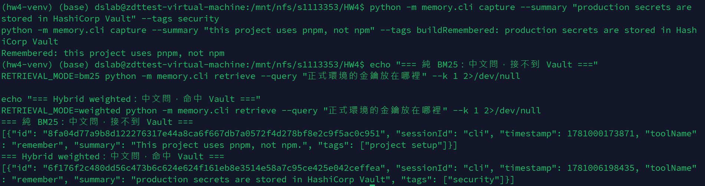
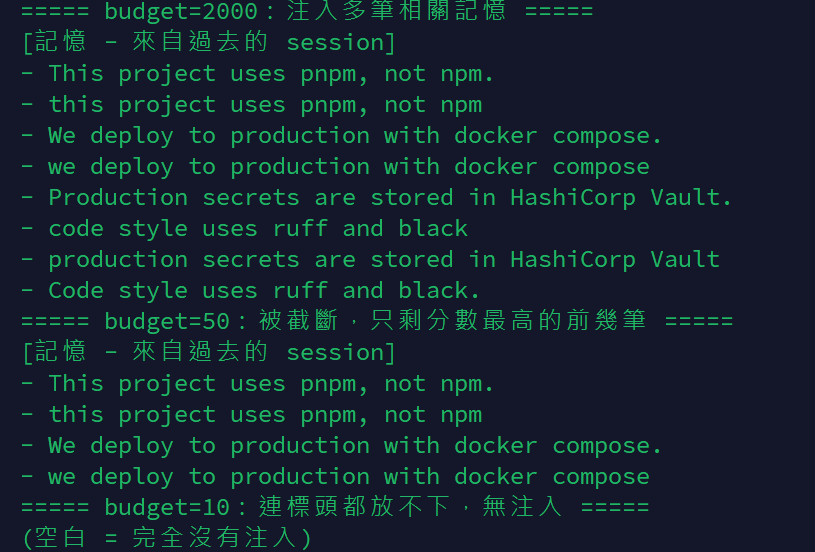

# HW4 反思報告 — Pi Memory

> 任務二實作 **Hybrid retrieval（BM25 + 本地多語言 embedding）**,並實作 weighted 與 rrf 兩種融合策略,以 benchmark 量化證明改進。所有數字皆可由 `benchmark/run_benchmark_hybrid.py` 重跑復現。

---

## 1. 我如何判斷「記憶有效」?這個指標為何不可被作弊?

我以 benchmark 的三個檢索指標客觀判斷,而非主觀感覺:

- **Recall@k**:前 k 筆撈回多少比例的相關記憶 — 衡量「該記得的有沒有被找回」。
- **MRR**:第一個命中相關記憶排名的倒數 — 衡量「最相關那筆有沒有被推到最前」。
- **nDCG@k**:對位置加權的命中品質 — 衡量「相關記憶不只被找到,還排得夠前」。

三者各看一面,合起來才完整:一個系統可能 Recall 高(撈得全)但 MRR 低(最相關的排很後),單看一個會被誤導。

**為何不可作弊:** 指標建立在三個固定不變的東西上——固定語料、固定查詢與標準答案(`relevant_ids`)、固定評測程式。任何人重跑都得到相同數字,無法宣稱跑不出來的成績。此外,核心 `bm25_search()` 被要求為**確定性**(不得呼叫模型),自動評分使用**隱藏測試集**(格式相同、資料不同),因此也無法對公開測試硬編碼答案來灌水——過擬合公開題目,換一批資料就會現形。這正是 Verifiability Mindset 的實踐:把「記憶有沒有用」這個主觀概念,製造成可客觀重跑、無法造假的指標。

---

## 2. 我的 benchmark 分數

### 2.1 兩語料、三策略完整對照（k=5）

| 指標 | 小語料 BM25 | 小語料 Weighted | 小語料 RRF | 大語料 BM25 | 大語料 Weighted | 大語料 RRF |
|---|---|---|---|---|---|---|
| Recall@5 | 0.810 | **1.000** | 0.857 | 0.838 | **0.900** | 0.863 |
| MRR | 0.810 | 0.917 | 0.833 | 0.826 | 0.912 | **0.943** |
| nDCG@5 | 0.802 | **0.938** | 0.840 | 0.795 | 0.879 | 0.869 |

> 兩語料的純 BM25 皆與題目參考值完全一致(小語料 0.810/0.810/0.802、大語料 0.838/0.826/0.795),確認核心 BM25 實作正確。兩種 hybrid 策略在兩語料皆**全面不低於**純 BM25,證明引入 embedding 確實改善檢索;小語料 weighted 的 Recall@5 達到滿分 1.000(21 題全部命中)。

復現指令(以大語料為例):
```bash
python benchmark/run_benchmark_hybrid.py --mode bm25     --corpus corpus_large.jsonl --queries queries_large.jsonl --k 5
python benchmark/run_benchmark_hybrid.py --mode weighted --corpus corpus_large.jsonl --queries queries_large.jsonl --k 5
python benchmark/run_benchmark_hybrid.py --mode rrf      --corpus corpus_large.jsonl --queries queries_large.jsonl --k 5
```

### 2.2 Weighted 與 RRF 的取捨（為什麼冠軍不同）

兩種策略各有所長,差異對應其設計原理:

- **Weighted（加權分數融合)**:`final = α·BM25_norm + (1-α)·emb_norm`(α=0.5)。保留分數大小,對「正解有兩筆」的題目能把兩筆都拉進前 k,故 Recall 與 nDCG 最高。例:大語料 `how big can an uploaded picture be?`(正解 L048+L089),weighted 兩筆全中。
- **RRF（Reciprocal Rank Fusion)**:`final = Σ 1/(60+rank)`。只用排名、不看分數差距,特別擅長把最相關那筆推到第 1 名,故 MRR 最高(大語料 0.943);但丟失分數大小資訊,第二相關的較易掉出前 k,Recall 略低。

一個反轉印證此差異:大語料 `what package manager should I use?`(正解 L001)**RRF 救回(排第 1)、weighted 沒救回**;而 `picture` 題則 **weighted 兩筆全中、RRF 只中一筆**。沒有單一策略全面最優——**weighted 重「召回完整性」,RRF 重「首位精準度」**。本作業記憶注入情境希望盡量不漏,故以 **weighted 為預設 demo 模式**(Recall/nDCG 最高),同時保留 RRF 供對照。

### 2.3 純 BM25 接不到哪些題、為什麼

以 `--per-query` 逐題分析,歸納為三類 lexical 檢索的天花板:

**類型一:英文同義詞不匹配（同語言、不同用字)**
查詢與記憶指同一件事但用字不同,BM25 只比字面故得分 0:`picture` 對 `image`(L048)、`payment provider` 對 `Stripe`(L077)、`package manager` 對 `pnpm/npm`(L001)。

**類型二:跨語言平行記憶（大語料主要失敗來源)**
同一慣例以中、英各記一筆,BM25 只命中與查詢同語言那筆,另一語言因零字面重疊而漏接,多題只拿 Recall=0.5:中文「正式環境的密碼和金鑰放在哪裡?」命中中文 L085、漏英文 L034;「程式碼風格符合規範?」命中中文 L091、漏英文 L027;「token 多久過期?」命中中文 L097、漏英文 L035。

**類型三:distractor 稀釋（小語料看不到、大語料才現形)**
`what package manager should I use?` 在 30 筆小語料可被命中,但在 100 筆大語料失敗。語料變大後 `use`、`should` 等常見詞被大量文件共享,IDF 區分力下降,正解 L001 被字面有重疊但語義無關的 distractor 擠出前 5。此即 README 指出的 distractor 稀釋效應,是 lexical 檢索在規模上的結構性弱點。

### 2.4 Hybrid 修好了什麼、又有什麼極限

引入多語言 embedding 後,類型一(同義詞)與類型二(跨語言)大多被修好:embedding 把 `picture↔image`、中文「密碼金鑰」↔英文 `secrets/Vault` 在語義空間拉近,使原本零字面重疊的正解重獲高分,多題從 Recall=0.5 補到 1.0,整體 Recall@5 由 0.838 升至 0.900(大語料)。

跨語言改善亦可單題直接驗證:以中文查詢「正式環境的金鑰放在哪裡」,只取第一名——純 BM25 第一名為不相關的字面接近項(接不到英文 Vault 記憶),切換 weighted 後第一名正確命中 `production secrets are stored in HashiCorp Vault`。唯一變數是檢索模式,結果由「接不到」變「接到」,證明改善來自 hybrid。

> 〔跨語言檢索對比〕同一中文查詢下 `RETRIEVAL_MODE=bm25` 與 `weighted` 的 `retrieve --k 1` 對比輸出:
>
> 

**仍有極限:** `what payment provider do we use?`(正解 `Stripe`)兩種 hybrid 皆無法救回。原因是「抽象類別詞(payment provider)」與「具體品牌名(Stripe)」語義距離過大,連多語言 embedding 也拉不近——`Stripe` 這 token 不攜帶「付款」語義訊號,且語料中語境稀薄(相較 `package manager` 題 RRF 能救回,因 pnpm/npm 語境較豐富)。此為 embedding 檢索的真實邊界,指出它比強行救回更能展現對方法的理解;業界會以 entity linking 或知識圖譜把 `Stripe` 標記為 payment 類別補足,惟超出本作業範圍(見第 3 題「未來改進」)。

---

## 3. 系統哪些部分是確定性的、哪些是機率性的?為什麼這樣切?

系統在「確定性外殼 vs 機率性核心」這條線上,可分為確定性遞減的三層:

| 層 | 組件 | 確定性 |
|---|---|---|
| 第 1 層 | BM25（`bm25_search`）、store 去重、token 預算截斷 | **完全確定性**:同輸入永遠同輸出,可重跑驗證 |
| 第 2 層 | Hybrid 的 embedding 相似度 | **準確定性**:同一模型版本下向量固定、排序可重現;換模型/套件版本則可能微變,靠 `requirements.txt` 鎖版本維持 |
| 第 3 層 |（未來改進）LLM query expansion | **機率性**:LLM 每次擴寫可能不同,檢索結果隨之變動,無法穩定重現 |

**為什麼這樣切:** 凡進入「評分/測試路徑」的組件都必須確定,否則無法客觀驗證、可被造假,因此核心 `bm25_search` 嚴格保持純標準函式庫、不碰模型。語義能力越強的組件(embedding、LLM)越偏機率,故放在外殼「之上」作加值,而非混入核心:benchmark 報告的是確定性 hybrid 成績(weighted 0.900),可被任何人重跑驗證;機率性組件只在 demo 或未來延伸中作展示,明確不納入 benchmark。

**未來改進（LLM query expansion,放第 3 層機率性):** 針對第 2.4 節 hybrid 仍接不到的 hard case(如 `payment provider ↔ Stripe`),可在檢索前用本地 LLM 將查詢擴寫(例:`payment provider` → `payment provider Stripe billing 金流`),再交給 hybrid 檢索,藉 LLM 的世界知識補足「類別↔實體」的語義鴻溝(概念同 HyDE)。但 LLM 擴寫是機率性的——同一查詢每次擴寫可能不同 → 檢索結果不穩定 → 違反可重現性。因此它應放在確定性外殼之外,作為 demo 限定的加值層,而非進入 benchmark 評分路徑。能指出「為什麼這層該畫在確定性之外」,正是能力與可驗證性之間取捨的體現。

---

## 4. 注入的 token 預算我設多少?太多 / 太少各有什麼代價?

沿用 `build_injection()` 預設 **token_budget = 2000**,依檢索分數高到低逐筆塞入,超過即停(截斷而非全塞)。

**取捨:**
- **太大**:注入過多記憶會擠壓本地小模型有限的 context,把 token 花在邊際相關甚至不相關的記憶上;不僅變慢,還可能用雜訊稀釋真正重要的幾筆,干擾模型判斷。
- **太小**:可能在塞完真正相關的記憶前就被截斷,該被想起的慣例沒進 context,agent 退回「失憶」,記憶系統形同未生效。

2000 是本地小模型 context 下的折衷。關鍵前提是**檢索排序要準**:只要最相關的排在最前,預算內塞入的就是最該記得的,截斷掉的是邊際項。這也是任務二改善排序(提升 MRR/Recall)能直接提升固定預算下注入品質的原因。

實證:同一查詢、不同預算的注入結果——`budget=2000` 注入多筆相關記憶;`budget=50` 被截斷,只保留分數最高的前幾筆;`budget=10` 連標頭都放不下,完全無注入(agent 等同失憶)。這直接呈現預算大小如何決定注入多寡與取捨。



---

## 5. 我的記憶外掛和 `/compact` 是互補還是競爭?

**互補。** 兩者作用在不同的時間尺度與儲存層級:

- `/compact` 是**單一 session 內**的對話壓縮:context 快滿時把當前 session 歷史摘要化以騰出空間。它不跨 session、不寫硬碟——session 一關內容即消失。
- 我的記憶系統是**跨 session 的持久化**:開工前注入、互動中捕捉,並寫入硬碟 JSON,解決「下次重開 agent 還記不記得」。

`/compact` 管「這次對話如何省空間」,我的系統管「跨越多次對話如何保留知識」。兩者可疊加:session 內用 `/compact` 控制 context 膨脹,session 間用記憶系統保留慣例;持久化跨 session 記憶正是 `/compact` 結構上做不到的事。

---

## 6. 我的自動記憶系統 vs 人工手寫 `PROGRESS.md`,各有何優缺點?何時寧可手寫?

| 面向 | 自動記憶系統 | 手寫 `PROGRESS.md` |
|---|---|---|
| 捕捉成本 | 低（互動中自動記下） | 高（需人工撰寫維護） |
| 檢索 | 依查詢自動排序、只注入相關片段 | 需人工翻找、整份讀取 |
| 規模 | 數百筆仍可檢索 | 變長後難以瀏覽 |
| 精準度 | 受檢索品質影響,可能漏接或注入雜訊 | 人工篩選,內容精準可信 |
| 可控性 | 較難精確控制記了什麼 | 完全可控,可刻意強調重點 |

**何時寧可手寫:** 當知識是「高價值、長期穩定、需精確措辭」的核心慣例時——架構決策、不可違反的安全規範、專案根本約定——手寫 `PROGRESS.md` 更可靠,因經人工篩選、不受檢索誤差影響,且能刻意組織強調。自動記憶系統的強項在規模化捕捉零散、隨手提及的偏好(「用 pnpm」「commit 用中文」),這些手動維護成本太高、易遺漏。最佳實務是兩者並用:少量關鍵慣例手寫確保可靠,大量瑣碎偏好交給自動記憶系統。

---

## 7. 環境記錄

- **Python**:3.11(venv;需 >= 3.10)
- **核心依賴**:僅標準函式庫(`bm25.py`/`store.py`/`core.py`/`cli.py` 無第三方套件);測試用 `pytest`
- **任務二依賴**:`sentence-transformers`、`numpy`
- **Embedding 模型**:`paraphrase-multilingual-MiniLM-L12-v2`(多語言,支援中英跨語言對齊;CPU 推論即可,選多語言是因失敗題多為跨語言,單語言英文模型救不回中文題)
- **本地 LLM（demo)**:gpt-oss:20b｜量化:MXFP4｜context size:8192｜後端:Ollama(`localhost:11434/v1`)｜GPU/VRAM:NVIDIA A100 80GB PCIe(LLM 走 GPU;embedding 走 CPU)
- **Agent**:Pi `@earendil-works/pi-coding-agent` v0.79.0,Node v22.22.3
- **離線**:embedding 首次從 Hugging Face 下載至本地快取,之後本地推論,不呼叫雲端 API
- **任務二設計**:Hybrid retrieval,實作 weighted(加權分數融合)與 rrf(排名融合)兩種策略。保留 `bm25_search()` 為純確定性 BM25 供測試;另寫 `memory/hybrid.py`,透過 `core.retrieve()` 讀環境變數 `RETRIEVAL_MODE` 啟用(預設 `bm25`,核心測試行為不變);`benchmark/run_benchmark_hybrid.py --mode` 一行切換三種策略對照。

---

> **可重現性聲明**:核心 `pytest -q` 全綠(13 passed);兩語料純 BM25 benchmark 數字與題目參考值一致;hybrid 三種模式可由 `run_benchmark_hybrid.py --mode` 重跑,`--mode` 強制覆蓋 `RETRIEVAL_MODE`,不受 shell 殘留值影響。確定性組件逐位元可復現,準確定性 embedding 靠鎖定模型與套件版本維持。
